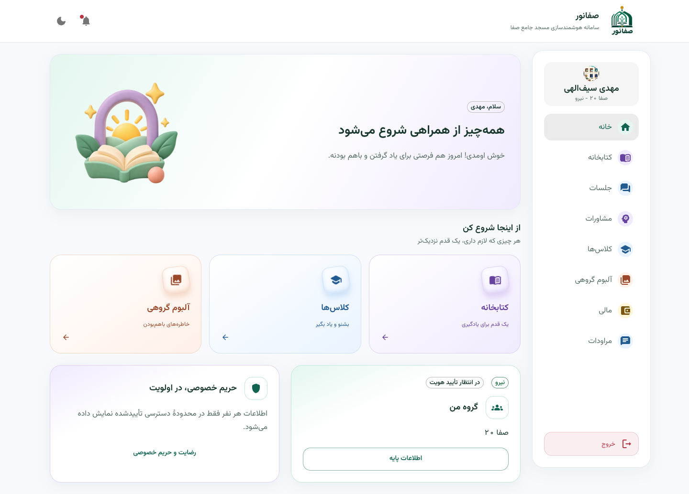
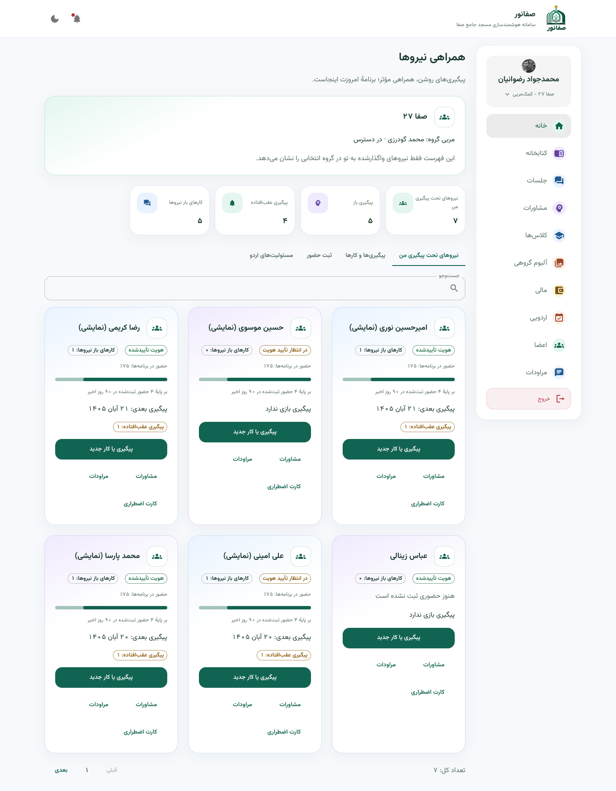
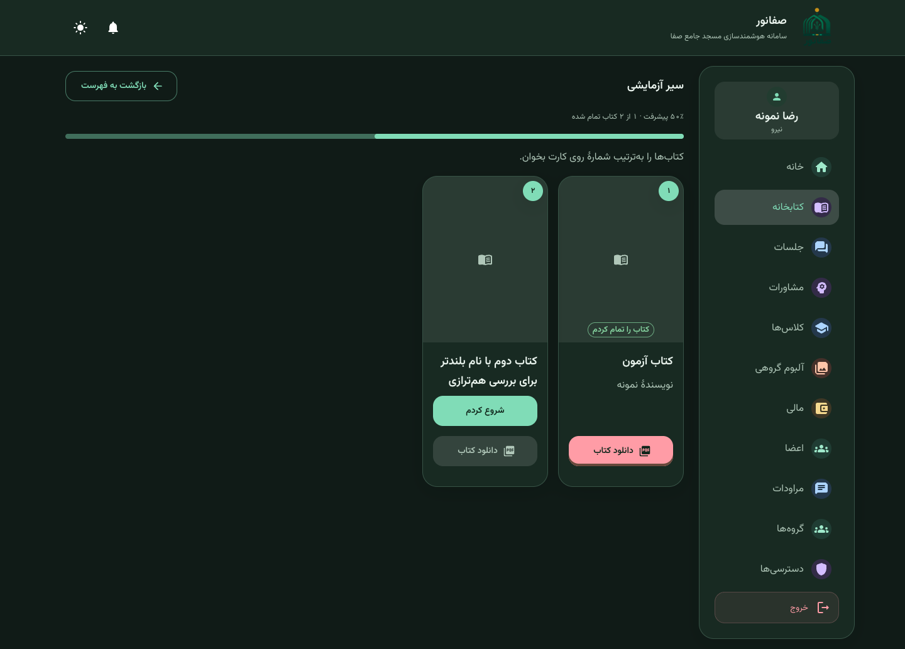
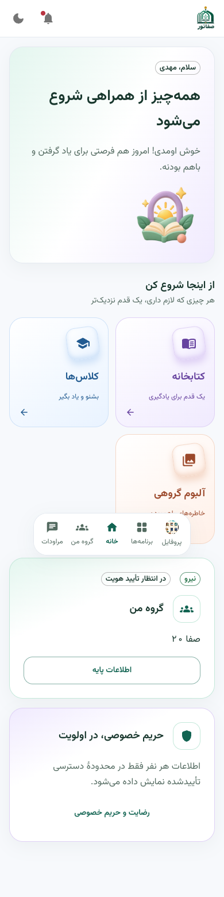
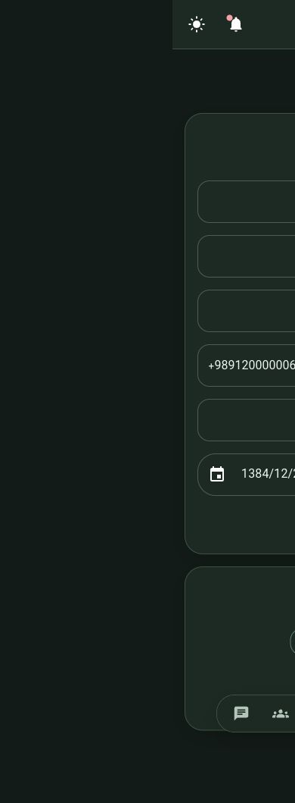
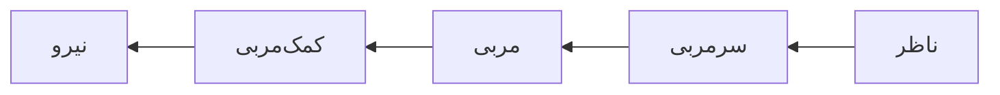
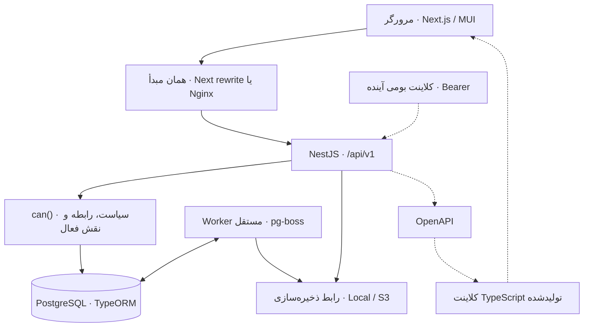

<a id="top"></a>

<div align="center" dir="rtl">


# صفانور · Safanoor

### همراهِ کار تربیتی، از گروه تا هر نفر

سامانهٔ مدیریت فعالیت‌های حضوری مسجد جامع صفا؛ برای همراهی نیروها، هماهنگی مربیان و ارتباط امن با خانواده‌ها.

<p>
  
  
  
  
</p>

<p>
  <a href="#preview">نمای سامانه</a> ·
  <a href="#features">امکانات</a> ·
  <a href="#quickstart">شروع سریع</a> ·
  <a href="#architecture">معماری</a> ·
  <a href="#docs">مستندات</a>
</p>

</div>

---

<div dir="rtl">

صفانور برای ساده‌تر کردن کار روزمرهٔ یک مجموعهٔ تربیتی ساخته می‌شود: شناخت اعضا، واگذاری پیگیری، ثبت حضور، مشاوره، اردو، مطالعه و مدیریت گروه. تجربهٔ نیروها برای موبایل و تجربهٔ مدیریت برای کار با اطلاعات و فرم‌ها طراحی شده است.

**حریم خصوصی بخشی از معماری محصول است.** نقش هر فرد، گروه انتخاب‌شده و رابطهٔ او با صاحب اطلاعات، دامنهٔ دسترسی را مشخص می‌کنند؛ تصمیم نهایی در API گرفته می‌شود.

> [!IMPORTANT]
> این مخزن در حال توسعه است. زیرساخت فاز اول و مجموعه‌ای از امکانات عملیاتی و MVP در آن وجود دارد؛ وجود یک صفحه یا ماژول، به‌معنای تکمیل همهٔ قواعد نسخهٔ نهایی آن حوزه نیست. مرز امکانات فعلی در بخش [وضعیت توسعه](#roadmap) آمده است. مرجع نیازمندی‌ها [AGENTS.md](AGENTS.md) است.

<a id="preview"></a>

## ✨ نمای سامانه

**خانهٔ نیرو — متناسب با پوستهٔ روشن یا تیرهٔ GitHub**

<picture>
  <source media="(prefers-color-scheme: dark)" srcset="docs/screens/recovered-member-1440-dark.png" />
  <source media="(prefers-color-scheme: light)" srcset="docs/screens/recovered-member-1440-light.png" />
  
</picture>

| همراهی نیروها در فضای کمک‌مربی | کتابخانه و پیشرفت مطالعه در حالت تیره |
| :---: | :---: |
| [](docs/screens/assistant-workspace-1440-light.png) | [](docs/screens/reading-pages-1440-dark.png) |

<details>
<summary><strong>📱 مشاهدهٔ نسخهٔ موبایل و تصاویر بیشتر</strong></summary>

<p align="center">
  
  
</p>

تصاویر ثبت‌شدهٔ رابط در [docs/screens](docs/screens/) و ویدیوهای معرفی نقش‌ها در [docs/videos](docs/videos/README.md) قرار دارند. این تصاویر نمونهٔ وضعیت رابط در زمان ثبت هستند؛ وضعیت امروز هر قابلیت را با کد و مستندات همان حوزه تطبیق دهید.

</details>

<a id="features"></a>

## 🧭 امکانات و تجربهٔ نقش‌ها

| حوزه | آنچه در مخزن فعلی وجود دارد |
| --- | --- |
| **افراد و گروه‌ها** | پروفایل، تأیید هویت، عضویت، سلسله‌مراتب و واگذاری پیگیری با حفظ تاریخچه |
| **نقش فعال** | جابه‌جایی بین مسئولیت‌های یک حساب؛ محدود شدن دسترسی به نقش و گروه انتخاب‌شده |
| **فضای کمک‌مربی** | نیروهای تحت پیگیری، کارها و پیگیری‌های موعددار، ثبت حضور برنامه‌های تک‌جلسه‌ای و مسئولیت‌های اردو |
| **مشاوره** | ثبت مشاورهٔ حضوری یا تلفنی، خلاصهٔ مشترک و یادداشت خصوصی با endpoint جدا |
| **کتابخانه** | سیر مطالعاتی گروه، فایل PDF، ثبت صفحهٔ جاری، سابقهٔ مطالعه و تأیید پایان کتاب |
| **جلسات و کلاس‌ها** | ثبت و ویرایش اطلاعات جلسات؛ مرور دوره‌ها، جلسه‌ها و دریافت محتوای صوتی مجاز |
| **آلبوم گروهی** | آلبوم‌ها، بارگذاری و مشاهدهٔ مجاز تصاویر، برچسب افراد، فیلتر «عکس‌های من» و مرتب‌سازی |
| **اردو و مالی MVP** | اطلاعات اردو و مجوز تصویری؛ مقصد هزینه و ریزهزینه‌های گروه، با مبلغ صحیح به تومان |
| **مراودات و اعلان‌ها** | گفتگوهای مجاز، پیام‌ها و اعلان‌های درون‌برنامه‌ای با وضعیت خواندن |
| **مدیریت** | مدیریت افراد و گروه‌ها، ورود CSV/XLSX با پیش‌نمایش، ارجاع‌ها، سیاست‌های دسترسی و گزارش ممیزی |
| **رضایت و خانواده** | رضایت نسخه‌دار، پیوند والد تأییدشده و پردازش گذار هجده‌سالگی |

سلسله‌مراتب پایهٔ سازمان:



نقش‌ها به رابطه و مسئولیت وابسته‌اند؛ یک فرد می‌تواند در گروهی نیرو، در گروهی کمک‌مربی و مالک گروه دیگری باشد. والد و مدیر فنی دسترسی‌های مستقل و محدود دارند. نقش گزارش‌گیری «مدیر مجموعه» نیز جدا تعریف شده و seed آن را به کسی واگذار نمی‌کند.

<a id="privacy"></a>

## 🛡️ حریم خصوصی و کنترل دسترسی

- **سیاست مرکزی:** تصمیم با `can(user, action, resource)`، سیاست‌های داده‌محور و اصل منع پیش‌فرض گرفته می‌شود. API اطلاعات را پیش از ارسال محدود می‌کند.
- **یادداشت خصوصی:** از خلاصهٔ مشترک جداست؛ سمت بالاتر یا مدیر فنی بودن، مجوز عمومی خواندن آن نیست.
- **دادهٔ حساس:** کد ملی با AES-GCM رمز می‌شود و HMAC مستقل برای یکتایی دارد؛ نمایش پایه پوشانده شده است. دسترسی اضطراری دلیل و ثبت ممیزی می‌خواهد.
- **نشست:** رمزها با Argon2id هش می‌شوند؛ access token کوتاه‌عمر و refresh token چرخشی است. وب از کوکی `httpOnly` و محافظت CSRF استفاده می‌کند؛ API مسیر احراز هویت Bearer برای کلاینت بومی هم دارد.
- **فایل و آفلاین:** فایل خصوصی از مسیر مجاز یا پیوند کوتاه‌عمر دریافت می‌شود. پوستهٔ PWA برای ذخیرهٔ آفلاین اطلاعات محافظت‌شده طراحی نشده است.

جزئیات اجرایی و محدودیت‌ها: [سیاست دسترسی](docs/ACCESS_POLICY.md) · [معماری](docs/ARCHITECTURE.md) · [پرسش‌های باز](docs/OPEN_QUESTIONS.md).

<a id="architecture"></a>

## 🏗️ معماری و فناوری‌ها

**دو برنامه، یک قرارداد API.** منطق کسب‌وکار و دسترسی در NestJS است؛ رابط Next.js قرارداد تولیدشده از OpenAPI و قابلیت‌های اعلام‌شده توسط سرور را مصرف می‌کند.



| لایه | فناوری و مسئولیت |
| --- | --- |
| رابط | Next.js 15، React 19، MUI 7، TanStack Query، React Hook Form و Zod |
| تجربهٔ فارسی | RTL، قلم Vazirmatn، تاریخ جلالی، i18n، پوستهٔ روشن/تیره و توکن‌های طراحی مشترک |
| API | NestJS 11، TypeScript strict، class-validator و Swagger/OpenAPI |
| داده | PostgreSQL 17، TypeORM، migration، queryهای پارامتری و ساختار سلسله‌مراتبی |
| کار پس‌زمینه | Nest standalone و صف PostgreSQL با pg-boss |
| فایل | آداپتور Local/S3؛ MinIO در توسعه و S3Proxy در Compose |
| آزمون و اجرا | Jest، تست HTTP با PostgreSQL، Playwright، Docker Compose و Nginx |

<details>
<summary><strong>📂 نقشهٔ مخزن</strong></summary>

```text
Safanoor/
├── api/                    # NestJS، ماژول‌ها، migration، seed و worker
│   ├── src/modules/        # دامنه‌ها و سیاست‌های API
│   ├── src/libs/           # پایگاه داده و زیرساخت مشترک
│   └── test/               # تست‌های یکپارچهٔ HTTP و PostgreSQL
├── ui/                     # Next.js App Router + MUI
│   ├── src/app/            # مسیرهای عضو و مدیریت
│   ├── src/api/generated/  # قرارداد TypeScript تولیدشده
│   └── src/theme/tokens.ts # منبع توکن‌های طراحی
├── packages/shared/        # Zod، تاریخ، کد ملی و نرمال‌سازی فارسی
├── scripts/                # توسعه، تولید قرارداد و بررسی‌ها
├── tests/                  # سناریوهای Playwright
├── infra/                  # reverse proxy، PostgreSQL و ذخیره‌سازی
├── docs/                   # معماری، سیاست‌ها، برنامه‌ها و تصاویر
├── compose.yaml            # اجرای سرویس‌ها با Docker
└── AGENTS.md               # مرجع نیازمندی‌های محصول و قواعد توسعه
```

</details>

<a id="quickstart"></a>

## 🚀 شروع سریع

### پیش‌نیازها

| ابزار | نسخه / نیاز |
| --- | --- |
| Node.js | ۲۴، مطابق محیط CI |
| npm | نصب وابستگی‌های ریشه، shared و API |
| Corepack + Yarn | Yarn Classic نسخهٔ `1.22.22` برای رابط |
| Docker | Docker Engine یا Desktop، همراه Compose v2 |
| پورت‌های توسعه | `3033`، `3001`، `55432`، `9000` و `9001` آزاد باشند |

### ۱. دریافت و نصب

```sh
git clone https://github.com/hajrezvan/Safanoor.git
cd Safanoor

corepack enable
npm ci
npm ci --prefix packages/shared
npm run build:shared
npm ci --prefix api
corepack yarn --cwd ui install --frozen-lockfile
node scripts/dev-env.mjs
```

اسکریپت محیط، فایل‌های محلی و کلیدهای تصادفی توسعه را می‌سازد. کلیدهای موجود API را نگه می‌دارد، اما تنظیمات پیش‌فرض ذخیره‌سازی API را به MinIO محلی برمی‌گرداند. این اسکریپت برای تنظیم محیط production نیست.

### ۲. آماده‌سازی پایگاه داده

برای یک نصب تازه، PostgreSQL توسعه را ایجاد و migration و seed را اجرا کنید:

```sh
docker run --name safanoor-postgres \
  -e POSTGRES_USER=safanoor \
  -e POSTGRES_PASSWORD=safanoor_dev \
  -e POSTGRES_DB=safanoor \
  -p 127.0.0.1:55432:5432 \
  -d postgres:17-alpine

# پس از آماده شدن PostgreSQL
npm --prefix api run migration:run
npm --prefix api run seed
```

اگر کانتینر از قبل وجود دارد و متوقف است، به‌جای ساخت دوباره از `docker start safanoor-postgres` استفاده کنید.

### ۳. اجرای توسعه

```sh
npm run dev
```

این دستور PostgreSQL و MinIO محلی را آماده و API، worker و رابط را اجرا می‌کند. در شروع پروژه همچنان باید migration و seed مرحلهٔ قبل اجرا شده باشند. `Ctrl+C` فرایندهای برنامه را می‌بندد؛ کانتینرهای PostgreSQL و MinIO روشن می‌مانند.

| سرویس | نشانی محلی |
| --- | --- |
| رابط وب | [localhost:3033](http://localhost:3033) |
| API نسخهٔ یک | [localhost:3001/api/v1](http://localhost:3001/api/v1) — پیشوند endpointها |
| Swagger در توسعه | [localhost:3001/api/docs](http://localhost:3001/api/docs) |
| سلامت API | [localhost:3001/api/v1/health](http://localhost:3001/api/v1/health) |
| MinIO | [127.0.0.1:9000](http://127.0.0.1:9000) |
| کنسول MinIO | [127.0.0.1:9001](http://127.0.0.1:9001) |

<details>
<summary><strong>اجرای جداگانهٔ API، worker و رابط</strong></summary>

پس از روشن شدن PostgreSQL و ذخیره‌سازی، هر دستور را در یک ترمینال اجرا کنید:

```sh
npm --prefix api run start:dev
```

```sh
npm --prefix api run worker
```

```sh
corepack yarn --cwd ui dev
```

درخواست‌های `/api/*` رابط با `API_INTERNAL_URL` به API فرستاده می‌شوند تا مرورگر با همان مبدأ کار کند. پردازش import و یادآوری‌ها به اجرای worker وابسته است.

</details>

<a id="demo"></a>

## 🎭 داده و حساب‌های نمایشی

> [!CAUTION]
> حساب‌های زیر مخصوص seed توسعه با دادهٔ مصنوعی‌اند. رمز مشترک اولیهٔ آن‌ها `12345678` است. seedهای نمایشی در `NODE_ENV=production` اجرا نمی‌شوند؛ از این حساب‌ها برای استفادهٔ واقعی سازمان استفاده نکنید.

| نقش | شمارهٔ ورود |
| --- | --- |
| مدیر فنی | `09100000040` |
| ناظر | `09100000001` |
| سرمربی | `09100000002` |
| مربی رویش | `09100000003` |
| مربی باران | `09100000004` |
| کمک‌مربی | `09100000005` |
| نیرو | `09100000011` |
| نیرو در انتظار رضایت والد | `09100000015` |
| والد تأییدشده | `09100000031` |

Seed پایه شامل ۱ ناظر، ۱ سرمربی، ۲ مربی، ۳ کمک‌مربی، ۱۲ نیرو، ۲ والد و ۱ مدیر بیرونی است. دادهٔ نمونهٔ حوزه‌های آینده در seed پایه، جای پیاده‌سازی آن حوزه‌ها را نمی‌گیرد. شرط پنج ناظر سازمان با seed پایه تأمین نمی‌شود و آمادگی سازمانی تا تکمیل آن برقرار نیست.

| دستور در `api` | کاربرد |
| --- | --- |
| `npm --prefix api run seed` | دادهٔ مصنوعی پایه؛ قابل اجرای مجدد |
| `npm --prefix api run seed:demo` | تکمیل دادهٔ ارائهٔ پایه، اعلان، import و ارجاع؛ حفظ تغییرات کاربر طبق راهنمای demo |
| `npm --prefix api run seed:hierarchy` | سلسله‌مراتب تست محلی بر اساس گروه‌های صفا؛ راهنمای جداگانه دارد |
| `npm --prefix api run seed:evening-demo` | افزودن نیروهای «نمایشی»، مشاوره، گفتگو و نمونه‌های فضای کمک‌مربی به سلسله‌مراتب موجود |

ترتیب و حساب‌های هر مجموعه داده متفاوت است؛ برای ارائه از [راهنمای demo](docs/DEMO.md)، [سلسله‌مراتب تست](docs/REAL_HIERARCHY_SEED.md) و [فضای کمک‌مربی](docs/phases/ASSISTANT_PRESENTATION.md) استفاده کنید. seed تکمیلی کمک‌مربی حساب یا رمز ورود موجود را تغییر نمی‌دهد.

<a id="quality"></a>

## 🧪 بررسی کیفیت و قرارداد API

```sh
# بررسی تجمیعی: typecheck، lint، تست‌ها، قرارداد و build رابط
npm run check

# تولید دوبارهٔ OpenAPI و کلاینت TypeScript
npm run contract

# بررسی تکرارپذیری دادهٔ پایه در محیط توسعه
npm --prefix api run seed
npm --prefix api run seed
```

تست‌های یکپارچه به PostgreSQL و کاربر دارای اجازهٔ ساخت دیتابیس نیاز دارند. متغیر `TEST_DATABASE_URL` باید به دیتابیسی با پسوند `_test` اشاره کند؛ مجموعه‌های تست دیتابیس آزمون و نام‌های مشتق‌شدهٔ خود را بازسازی می‌کنند. از دیتابیس مستقل آزمون استفاده کنید.

پس از اجرای API، worker و رابط با seed پایه:

```sh
npx playwright install chromium
npm run test:worker
npm run test:e2e
```

روی macOS، تنظیم پیش‌فرض Playwright از Chrome نصب‌شده استفاده می‌کند؛ در CI از Chromium استفاده می‌شود. برای Chromium محلی در لینوکس:

```sh
CI=true npm run test:e2e
```

دروازهٔ بصری پروژه شامل ثبت و بازبینی صفحات اصلی در عرض‌های **۳۹۰ و ۱۴۴۰ پیکسل** و هر دو پوسته است. [گزارش اعتبارسنجی پایه](docs/VALIDATION.md) و گزارش‌های [تغییرات بعدی](docs/phases/) نتایج ثبت‌شده در زمان خود را نگه می‌دارند؛ badgeهای این README ادعای اجرای موفق CI نیستند.

> [!NOTE]
> پیکربندی CI موجود در `.gitlab-ci.yml` برای Hamgit/GitLab است. انتقال ریموت به GitHub آن را به GitHub Actions تبدیل نمی‌کند؛ اجرای بررسی‌ها در GitHub به workflow جداگانه نیاز دارد.

<a id="deployment"></a>

## 📦 Docker و استقرار

اجرای کل استک با Node.js برای تولید تنظیمات اولیه و Docker Compose:

```sh
node scripts/dev-env.mjs
docker compose up --build -d
```

رابط و API پشت Nginx از [localhost:8080](http://localhost:8080) در دسترس‌اند. Compose شامل PostgreSQL، S3Proxy خصوصی، آماده‌سازی bucket، migration، backend، worker و frontend است. دادهٔ demo خودکار درج نمی‌شود.

```sh
# فقط در محیط آزمایشی؛ درج دادهٔ پایه پس از آماده شدن سرویس‌ها
docker compose run --rm -e NODE_ENV=development backend node dist/seed.js

# مشاهدهٔ وضعیت و لاگ سرویس‌ها
docker compose ps
docker compose logs -f backend worker frontend
```

<details>
<summary><strong>⚙️ تنظیمات مهم و نخستین مدیر واقعی</strong></summary>

| تنظیم | کاربرد |
| --- | --- |
| `DATABASE_URL` | اتصال API و worker به PostgreSQL |
| `APP_ORIGIN` | مبدأ واقعی وب برای کنترل Origin و نشست |
| `JWT_SECRET` | امضای توکن‌های احراز هویت |
| `ENCRYPTION_KEY_ID` و `ENCRYPTION_KEYS` | کلید جاری و مجموعهٔ کلیدهای نسخه‌دار رمزگذاری |
| `NATIONAL_ID_HMAC_KEY` | راز مستقل برای یکتایی کد ملی |
| `STORAGE_SIGNING_KEY` | امضای دسترسی فایل در آداپتور مربوطه |
| `STORAGE_DRIVER` و `S3_*` | آداپتور، endpoint، bucket و اطلاعات اتصال ذخیره‌سازی |
| `S3_PUBLIC_ENDPOINT` | نشانی ذخیره‌سازی قابل دسترس کاربر برای URLهای امضاشده |
| `API_INTERNAL_URL` | نشانی داخلی API برای proxy رابط |
| `MONEY_UNIT` | واحد پول؛ پیش‌فرض `toman` |

نمونه‌ها: [محیط API](api/.env.example)، [محیط رابط](ui/.env.example) و [محیط Compose](.env.example). فایل‌های واقعی محیط و کلیدها نباید در Git قرار بگیرند.

برای نخستین مدیر، این چهار متغیر را در محیط امن تنظیم کنید:

- `BOOTSTRAP_ADMIN_PHONE`
- `BOOTSTRAP_ADMIN_PASSWORD` — حداقل ۱۲ نویسه
- `BOOTSTRAP_ADMIN_FIRST_NAME`
- `BOOTSTRAP_ADMIN_LAST_NAME`

سپس در محیط API اجرا کنید:

```sh
npm --prefix api run bootstrap
```

در کانتینر، entrypoint معادل `node dist/bootstrap-admin.js` است؛ متغیرها باید به کانتینر هم منتقل شوند. ابزار پس از وجود نخستین مدیر متوقف می‌شود و مدیر تازه در اولین ورود رضایت را ثبت می‌کند.

برای production، TLS در reverse proxy بیرونی، مبدأ واقعی، کلیدها و رمزهای مستقل و endpoint قابل دسترس ذخیره‌سازی را تنظیم کنید. Compose مالک migration را از نقش runtime پایگاه داده جدا می‌کند. تنظیمات و داده‌های توسعه جای آماده‌سازی محیط واقعی را نمی‌گیرند.

</details>

<a id="roadmap"></a>

## 🗺️ وضعیت توسعه و مسیر پیش رو

موارد علامت‌خورده، قابلیت موجود را نشان می‌دهند؛ پذیرش کامل هر فاز به دروازه‌های تعریف‌شده در [AGENTS.md](AGENTS.md) وابسته است.

- [x] زیرساخت هویت، گروه، سلسله‌مراتب، سیاست مرکزی، رضایت، اعلان و ورود گروهی
- [x] رابط فارسی و RTL، توکن‌های طراحی، پوسته‌های روشن/تیره و پوستهٔ PWA
- [x] فضای عملیاتی کمک‌مربی، ثبت حضور تک‌جلسه‌ای و پیگیری موعددار
- [x] مشاورهٔ MVP، کتابخانه و مطالعهٔ شخصی، آلبوم و امکانات پایهٔ جلسات، کلاس‌ها، اردو و هزینه‌ها
- [ ] زمان‌بندی تکرارشونده، RSVP، تعارض و پیشنهاد زمان مشترک به‌صورت کامل
- [ ] انتشار خلاصهٔ مشاوره برای والد و تکمیل چرخهٔ اردو، مجوز PDF و حضور روزانه
- [ ] کیف پول، دفترکل تغییرناپذیر، تحویل وجه، تسویهٔ اردو و گردش کامل پروژه‌ها
- [ ] بارگذاری قابل ادامه، پردازش صوت، صورت‌جلسهٔ ساختاریافته و چرخهٔ انتشار/لغو LMS
- [ ] تکمیل قواعد انتشار عمومی آلبوم، از جمله حذف metadata تصویر و رضایت همهٔ افراد برچسب‌خورده
- [ ] تکمیل نگهداری، خروج/بازگشت، حذف کامل و سخت‌سازی نهایی

**محدودیت‌های قابل توجه:** کارهای پیگیری کمک‌مربی جای ماژول پروژه را نمی‌گیرند. پیش‌نمایش مالی نیرو در توسعه مصنوعی است و بدهی یا پرداخت واقعی ایجاد نمی‌کند. کلاس‌های موجود به‌معنای تکمیل انتشار عمومی LMS نیستند. جزئیات باز و تصمیم‌های تأییدنشده در [OPEN_QUESTIONS.md](docs/OPEN_QUESTIONS.md) ثبت می‌شوند.

اتصال به API هوش مصنوعی، تشخیص چهره، درگاه پرداخت آنلاین و ارسال پیامک/پیام‌رسان در دامنهٔ نسخهٔ اول نیستند. اپ بومی برای آینده پیش‌بینی شده است.

<a id="docs"></a>

## 📚 راهنمای مستندات

| سند | برای چه کسی / چه کاری؟ |
| --- | --- |
| [نیازمندی‌ها و قواعد توسعه](AGENTS.md) | شناخت محصول، ترتیب فازها و تعریف اتمام کار |
| [معماری](docs/ARCHITECTURE.md) | تصمیم‌های فنی، مرز ماژول‌ها و وضعیت پیاده‌سازی |
| [سیاست دسترسی](docs/ACCESS_POLICY.md) | قواعد دیدن و تغییر اطلاعات و محدودیت نقش‌ها |
| [پرسش‌های باز](docs/OPEN_QUESTIONS.md) | فرض‌ها و تصمیم‌های نیازمند تأیید |
| [اعتبارسنجی پایه](docs/VALIDATION.md) | نتایج ثبت‌شدهٔ بررسی‌های فاز اول |
| [برنامه‌ها و گزارش تغییرات](docs/phases/) | دامنه، محدودیت و بررسی هر تغییر |
| [دادهٔ ارائه](docs/DEMO.md) | حساب‌ها و سناریوهای نمایشی پایه |
| [سلسله‌مراتب تست محلی](docs/REAL_HIERARCHY_SEED.md) | آماده‌سازی گروه‌های صفا برای ارائه |
| [فضای کمک‌مربی](docs/phases/ASSISTANT_PRESENTATION.md) | پیگیری، حضور، کارت اضطراری و fixtureهای ارائه |
| [ویدیوهای نقش‌ها](docs/videos/README.md) | معرفی تصویری تجربهٔ نقش‌ها در فاز اول |

<a id="contributing"></a>

## 🤝 توسعه و مشارکت

پیش از تغییر، [AGENTS.md](AGENTS.md) و مستندات حوزهٔ مربوط را بخوانید. endpointهای محافظت‌شده باید از سیاست مرکزی عبور کنند و تست دسترسی داشته باشند. قرارداد API را پس از تغییر endpointها بازتولید کنید؛ رنگ، فاصله، شعاع و تایپوگرافی رابط از `ui/src/theme/tokens.ts` می‌آیند. تغییرات بصری با تصاویر موبایل/دسکتاپ و روشن/تیره بررسی می‌شوند.

در نسخهٔ فعلی مجوز عمومی در ریشهٔ مخزن تعریف نشده و بستهٔ API با `UNLICENSED` مشخص شده است؛ برای استفاده یا بازتوزیع، شرایط مجوز باید با مالک پروژه روشن شود. قالب‌های NestJS و Next.js/MUI مبنای توسعهٔ موجود حفظ شده‌اند و مجوز وابستگی‌ها مستقل است.

---

<div align="center">

**صفانور — فرصتی بیشتر برای همراهی، با کارهای روزمرهٔ ساده‌تر**

[مخزن پروژه](https://github.com/hajrezvan/Safanoor) · [مستندات معماری](docs/ARCHITECTURE.md) · [بازگشت به ابتدا](#top)

</div>

</div>
