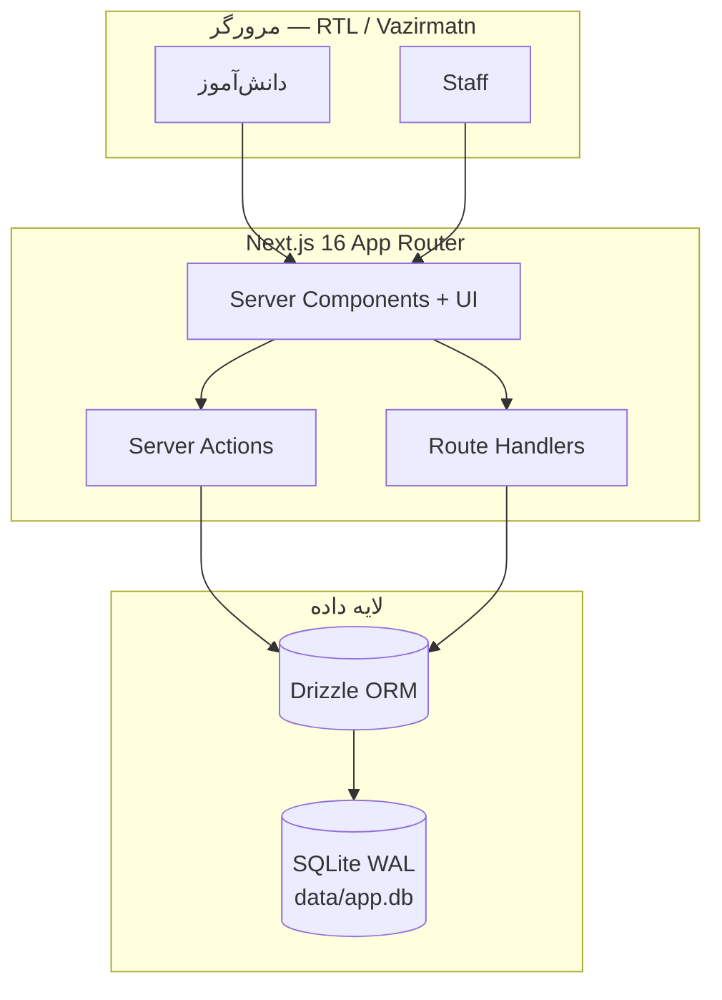

<div align="center">

# 🌿 صفا نور — Safanoor

### سامانه تربیتی نوجوانان

یک Monolith کامل با Next.js برای مربی‌گری، یادگیری، کتابخانه، پیامرسان و پیگیری رشد نوجوانان — **فارسی، RTL، آمادهٔ دمو**.

[](https://nextjs.org/)
[](https://react.dev/)
[](https://www.typescriptlang.org/)
[](https://orm.drizzle.team/)
[](https://tailwindcss.com/)
[](#)

<br/>

| 🏠 دانش‌آموز | 🧑‍🏫 Staff | 🗄️ دیتابیس | 🐳 استقرار |
|:---:|:---:|:---:|:---:|
| Bottom nav موبایل | پنل مشترک `/staff` | SQLite + WAL | یک Dockerfile |

<br/>

```bash
npm install && cp .env.example .env.local
npm run db:migrate && npm run db:seed && npm run dev
```

🌐 **[http://localhost:3000](http://localhost:3000)**

</div>

---

## 📑 فهرست مطالب

- [دربارهٔ پروژه](#-دربارهٔ-پروژه)
- [ویژگی‌ها](#-ویژگی‌ها)
- [معماری در یک نگاه](#-معماری-در-یک-نگاه)
- [پیش‌نیازها](#-پیش‌نیازها)
- [شروع سریع](#-شروع-سریع)
- [حساب‌های دمو](#-حساب‌های-دمو)
- [مسیرهای UI](#-مسیرهای-ui)
- [دیتابیس و Migration](#-دیتابیس-و-migration)
- [اسکریپت‌های npm](#-اسکریپت‌های-npm)
- [Docker](#-docker)
- [بررسی کیفیت](#-بررسی-کیفیت)
- [دود End-to-End](#-دود-end-to-end)
- [ساختار پوشه‌ها](#-ساختار-پوشه‌ها)
- [اسناد مرتبط](#-اسناد-مرتبط)
- [عیب‌یابی](#-عیب‌یابی)

---

## ✨ دربارهٔ پروژه

**صفا نور** پلتفرم تربیتی برای حلقه‌های نوجوان است. مربی و کمک‌مربی پروندهٔ رشد را مدیریت می‌کنند؛ دانش‌آموز در مدرسه درس می‌خواند، در کتابخانه مطالعه و آزمون می‌دهد، با پشتیبان چت می‌کند و پروفایل شخصی‌اش را تکمیل می‌کند.

> 💡 **هدف MVP:** یک codebase واحد (UI + Server Actions + SQLite) با یک ایمیج Docker — بدون microservice و بدون IdP خارجی.

### چه چیزی متمایزش می‌کند؟

| | |
|---|---|
| 🇮🇷 | UI کاملاً **فارسی / RTL** با فونت **Vazirmatn** |
| 🔐 | Auth سفارشی با **argon2id** + session cookie |
| 👥 | چهار نقش با **scoping** دسترسی |
| 📚 | محتوای seed **اسلامی / شیعی** برای دموی واقعی |
| ⏱️ | آزمون زمان‌دار با بانک سوال و شرکت مجدد |
| 📝 | جزوهٔ فردی درس + دانلود **PDF فارسی** |

---

## 🚀 ویژگی‌ها

<table>
<tr>
<td width="50%" valign="top">

### دانش‌آموز
- 🏠 **خانه** — اطلاعیهٔ آخر + آمار پیشرفت
- 🎓 **مدرسه** — دوره‌ها، درس‌ها، مدیا (ویدیو/صوت/PDF)
- 📖 **کتابخانه** — جلد کتاب، پیشرفت بر اساس آزمون
- ✅ **آزمون** — آمادگی → زمان‌دار → نتیجهٔ درصدی
- 💬 **پیامرسان** — inbox → thread
- 👤 **پروفایل** — اطلاعات پایه / خانوادگی / تیم پشتیبانی
- 📒 **جزوه من** — نوشتن + دانلود PDF

</td>
<td width="50%" valign="top">

### Staff (ادمین / مربی / کمک‌مربی)
- 🧭 پنل یکپارچه **`/staff`**
- 🧑‍🤝‍🧑 مدیریت **نیروها** و پیشرفت
- 🧑‍🏫 **کمک‌مربیان** و چت‌های مرتبط
- 📚 **کتابخانه** و سرفصل/آزمون
- 🏫 **کلاس‌ها** و محتوای درس
- 📢 **اطلاعیه‌ها**
- 🤖 **مربی‌یار AI** (mock / قابل توسعه)

</td>
</tr>
</table>

---

## 🏗 معماری در یک نگاه



| لایه | انتخاب |
|------|--------|
| Framework | Next.js **16** (App Router) + React **19** + TypeScript |
| ORM / DB | **Drizzle** + `better-sqlite3` |
| UI | Tailwind **v4** + shadcn-style + Iconify / Lucide |
| Auth | Session سفارشی — argon2id |
| تست | Vitest |
| استقرار | Dockerfile واحد + Compose |

جزئیات تصمیمات: [`STACK_DECISIONS.md`](./STACK_DECISIONS.md)

---

## ✅ پیش‌نیازها

| ابزار | نسخه |
|-------|------|
| Node.js | **24+** (پیشنهادی) |
| npm | همراه Node |
| Docker | اختیاری — برای استقرار |

---

## ⚡ شروع سریع

```bash
# ۱) کلون
git clone git@hamgit.ir:alghadir/safanoor.git
cd safanoor

# ۲) وابستگی‌ها
npm install

# ۳) تنظیم محیط
cp .env.example .env.local

# ۴) دیتابیس + دادهٔ دمو
npm run db:migrate
npm run db:seed

# ۵) اجرا
npm run dev
```

باز کردن: **[http://localhost:3000](http://localhost:3000)**

<details>
<summary><b>محتوای <code>.env.local</code></b></summary>

```env
DATABASE_PATH=./data/app.db
NODE_ENV=development
```

</details>

> ⚠️ بعد از هر pull که schema عوض شده باشد، حتماً دوباره `npm run db:migrate` بزنید.

---

## 🔑 حساب‌های دمو

پس از `npm run db:seed`:

| نقش | نام کاربری | رمز عبور |
|:---:|:----------:|:--------:|
| 👑 مدیر | `admin` | `Admin@1234` |
| 🧑‍🏫 مربی | `mentor1` … `mentor3` | `Mentor@1234` |
| 🤝 کمک‌مربی | `assistant1` … `assistant6` | `Assist@1234` |
| 🎒 دانش‌آموز | `student1` … `student30` | `Student@1234` |

Seed شامل پایه‌ها، گروه‌ها، مسیر رشد، دوره‌ها، کتاب‌های معارفی، اهداف/اقدامات، جلسات، چت، ارجاع، فعالیت، بانک دانش، اطلاعیه و آزمون است — **فارسی و بدون lorem**.

---

## 🗺 مسیرهای UI

### دانش‌آموز

| مسیر | توضیح |
|------|--------|
| `/student` | خانه |
| `/student/school` | مدرسه / دوره‌ها |
| `/student/library` | کتابخانه |
| `/student/messenger` | پیامرسان |
| `/student/profile` | پروفایل |

Bottom nav موبایل: **پروفایل · کتابخانه · خانه · مدرسه · پیامرسان**

### Staff

| مسیر | توضیح |
|------|--------|
| `/staff` | داشبورد مشترک |
| `/staff/forces` | نیروها |
| `/staff/assistants` | کمک‌مربیان |
| `/staff/library` | کتابخانه |
| `/staff/classes` | کلاس‌ها |
| `/staff/announcements` | اطلاعیه‌ها |

ادمین علاوه بر این‌ها به مسیرهای مدیریت سامانه (کاربران، پایه‌ها، …) دسترسی دارد.

---

## 🗄 دیتابیس و Migration

| محیط | مسیر فایل |
|------|-----------|
| محلی | `./data/app.db` (یا `DATABASE_PATH`) |
| Docker | `/data/app.db` روی volume |

**PRAGMAها:** `WAL` · `foreign_keys=ON` · `busy_timeout=5000`

```bash
npm run db:generate   # بعد از تغییر schema
npm run db:migrate    # اعمال migrationها
npm run db:seed       # دادهٔ دمو (idempotent)
npm run db:studio     # Drizzle Studio
```

Migrationهای فعلی از `0000` تا `0011` (شامل پروفایل، آزمون، آواتار، بانک سوال، جزوه، مدرسه).

---

## 📜 اسکریپت‌های npm

| دستور | کاربرد |
|-------|--------|
| `npm run dev` | توسعه با Turbopack |
| `npm run build` | ساخت production |
| `npm start` | اجرای build |
| `npm run typecheck` | بررسی TypeScript |
| `npm test` | Vitest |
| `npm run lint` | ESLint |
| `npm run db:migrate` | اعمال migration |
| `npm run db:seed` | seed کامل |
| `npm run db:generate` | تولید migration از schema |
| `npm run db:studio` | مشاهدهٔ DB |

---

## 🐳 Docker

به‌خاطر native deps (`better-sqlite3` / `argon2`) روی macOS ابتدا روی میزبان build بگیرید:

```bash
npm run build
docker build -t safanoor .
docker run --rm -p 3000:3000 -e RUN_SEED=true -v safanoor_data:/data safanoor
```

یا با Compose:

```bash
npm run build
docker compose up --build
```

| مورد | مقدار |
|------|--------|
| پورت | `3000` |
| Volume | `safanoor_data` → `/data` |
| Entrypoint | migrate → (اختیاری seed) → `node server.js` |

> **نکته WAL:** مسیر `/data` باید volume محلی/bind باشد (نه NFS).

---

## 🧪 بررسی کیفیت

```bash
npm run typecheck
npm test
npm run build
npm run lint   # بعضی هشدارها قابل قبول‌اند
```

---

## 🧭 دود End-to-End

بعد از seed این مسیرها را سریع چک کنید:

1. **`admin`** → ایجاد/ویرایش دانش‌آموز و پرونده رشد  
2. **`mentor1`** → دانش‌آموزان محدوده، هدف/برنامه/اقدام، مربی‌یار AI  
3. **`assistant1`** → چت، جلسه، ارجاع، پیگیری  
4. **`student1`** → مدرسه، کتابخانه + آزمون، پیامرسان، پروفایل، جزوه  
5. تب تاریخچه پرونده → تخصیص مربی + رویدادهای audit  

---

## 📁 ساختار پوشه‌ها

```text
safanoor/
├── src/
│   ├── app/                 # App Router (admin / staff / student / api)
│   ├── components/          # UI + patterns + domain
│   ├── db/                  # schema · migrate · seed
│   ├── server/              # actions · modules · auth
│   ├── lib/                 # utils · enums · digits
│   └── fonts/               # Vazirmatn (PDF + وب)
├── drizzle/                 # SQL migrations
├── public/                  # covers · avatars · fonts
├── tests/                   # Vitest
├── docs/                    # DOD + گزارش فازها
├── docker/                  # entrypoint · seed داکر
└── data/                    # SQLite محلی (gitignore)
```

جزئیات بیشتر: [`STACK_DECISIONS.md`](./STACK_DECISIONS.md)

---

## 📚 اسناد مرتبط

| سند | موضوع |
|-----|--------|
| [`STACK_DECISIONS.md`](./STACK_DECISIONS.md) | تصمیمات فنی و دلایل |
| [`TASKS.md`](./TASKS.md) | چک‌لیست فازها |
| [`OPEN_QUESTIONS.md`](./OPEN_QUESTIONS.md) | سوالات باز |
| [`docs/DOD.md`](./docs/DOD.md) | Definition of Done |
| [`docs/phases/`](./docs/phases/) | گزارش‌های فاز |

---

## 🛠 عیب‌یابی

<details>
<summary><b>صفحه سیاه / حلقهٔ ریدایرکت بعد از seed</b></summary>

<br/>

کوکی نشست قدیمی ممکن است نامعتبر شود. به `/login` بروید و دوباره وارد شوید (`student1` / `Student@1234`).

</details>

<details>
<summary><b>خطای <code>no such column</code> / schema</b></summary>

<br/>

```bash
npm run db:migrate
npm run db:seed
```

سپس `npm run dev` را ری‌استارت کنید.

</details>

<details>
<summary><b>کارت‌های تکراری در کتابخانه</b></summary>

<br/>

با migration یکتایی `(student_id, book_id)` و seed idempotent رفع شده. در صورت دادهٔ قدیمی:

```bash
npm run db:migrate && npm run db:seed
```

</details>

---

<div align="center">

<br/>

**ساخته‌شده با ❤️ برای حلقه‌های تربیتی صفا نور**

`git@hamgit.ir:alghadir/safanoor.git`

<br/>

</div>
